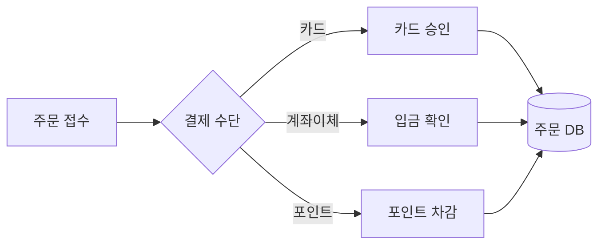
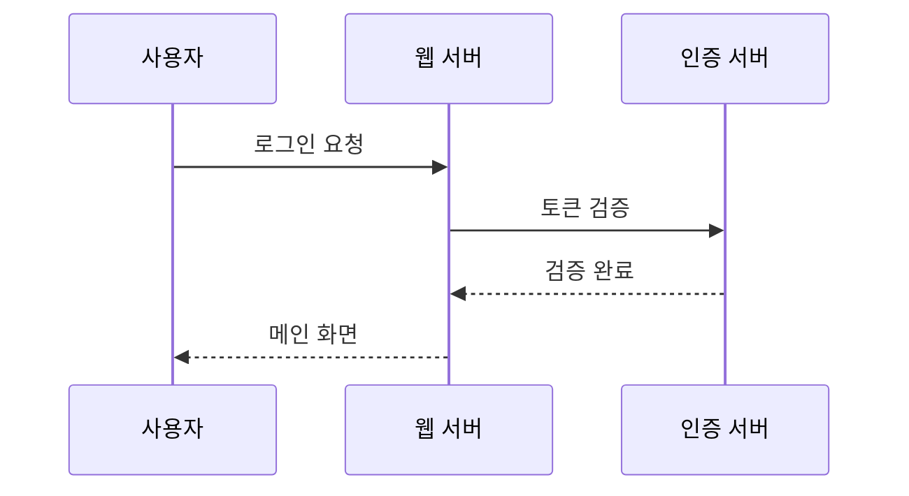
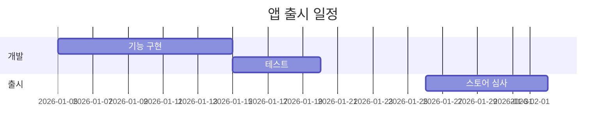
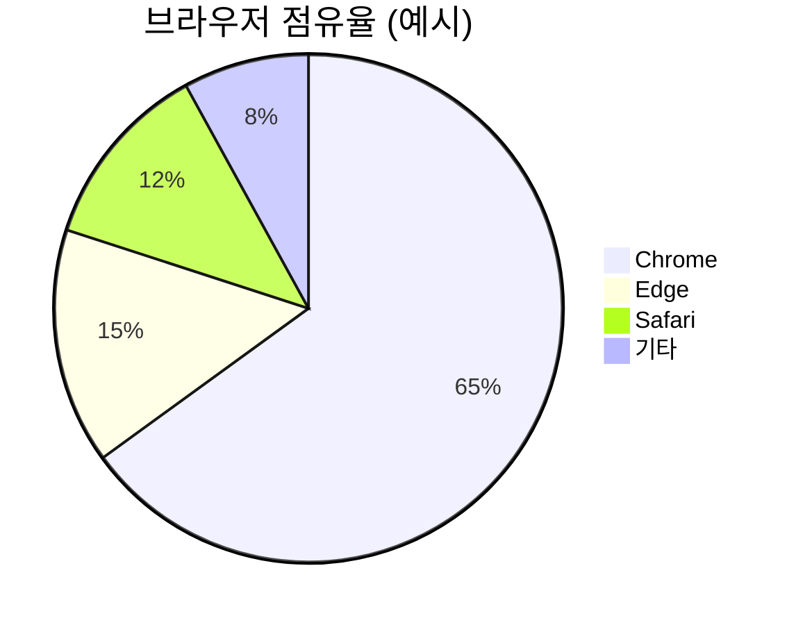

# Markdown Viewer 기능 샘플

브라우저에서 `.md` 파일을 열면 **자동으로** 렌더링됩니다. 목차·테마·글자크기는 상단바에서 바꿀 수 있고, `?` 를 누르면 단축키가 나옵니다.

> [!NOTE]
> GitHub 스타일 알림 박스를 지원합니다.

> [!TIP]
> 다이어그램 위에 마우스를 올리면 **코드 보기 / 복사 / SVG 저장 / 크게 보기** 버튼이 나옵니다.

> [!WARNING]
> 로컬 파일은 확장 설정에서 "파일 URL에 대한 액세스 허용"을 켜야 열립니다.

## Mermaid 다이어그램

### 흐름도



### 시퀀스



### 간트 / 파이





### 문법 오류 예시

```mermaid
flowchart TD
    A --> 
```

## 코드 하이라이트

```java
/**
 * 장바구니 합계 계산
 */
public BigDecimal getTotal(List<Item> items) {
    return items.stream()
        .map(i -> i.getPrice().multiply(BigDecimal.valueOf(i.getQty())))
        .reduce(BigDecimal.ZERO, BigDecimal::add); // 수량 × 단가 합산
}
```

```sql
SELECT id, name, price
  FROM products
 WHERE category = 'book'
   AND stock > 0;
```

```diff
- const width = 32;
+ const width = 48;
```

인라인 코드: `Array.prototype.map` 과 단축키 <kbd>Ctrl</kbd>+<kbd>P</kbd>.

## 표

| 테마 | 배경 | 용도 |
|:--|:--:|--:|
| 라이트 | 흰색 | 기본 |
| 다크 | 검정 | 야간 |
| 아이보리 | 아이보리색 | 장문 읽기 |

## 체크리스트

- [x] Mermaid 렌더링
- [x] KaTeX 수식
- [ ] 다음 기능 고민

## 수식

인라인 수식 $E = mc^2$ 와 블록 수식:

$$
x = \frac{-b \pm \sqrt{b^2 - 4ac}}{2a}
$$

## 각주와 기타

근의 공식[^1]은 이차방정식의 해를 구합니다.

<details>
<summary>접기/펼치기</summary>

숨겨진 내용입니다.

</details>

---

[^1]: $ax^2 + bx + c = 0$ 형태의 방정식.
